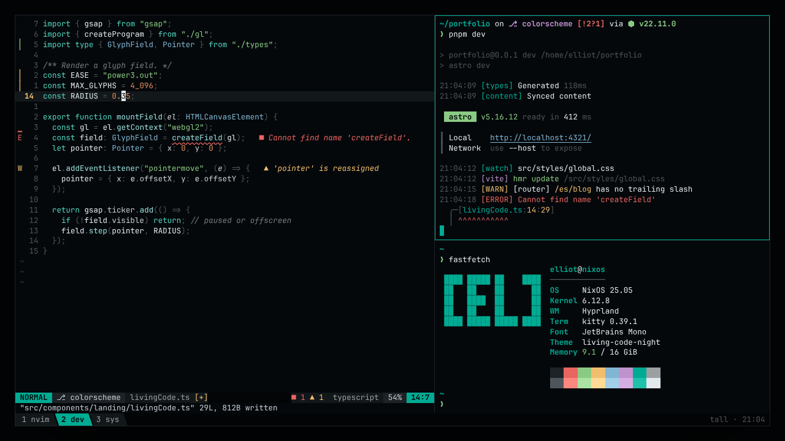
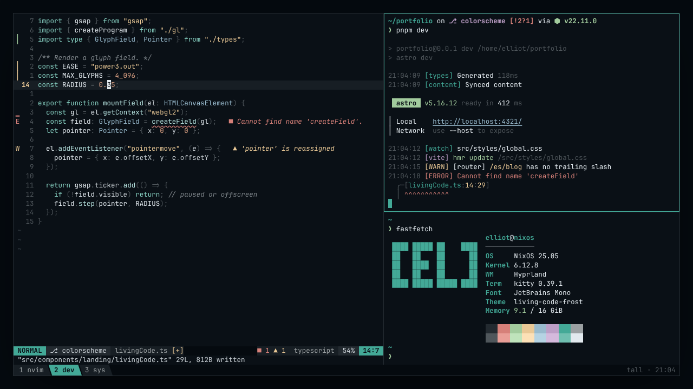
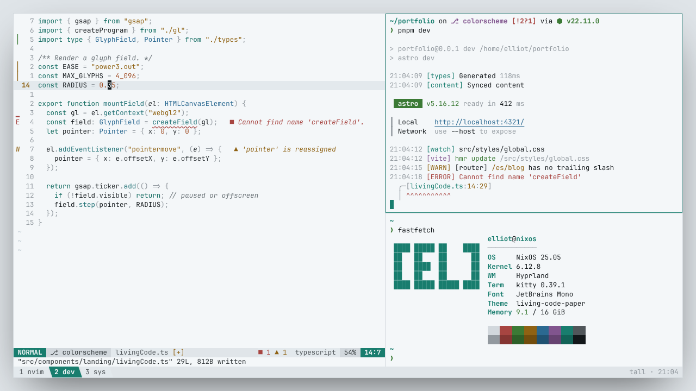
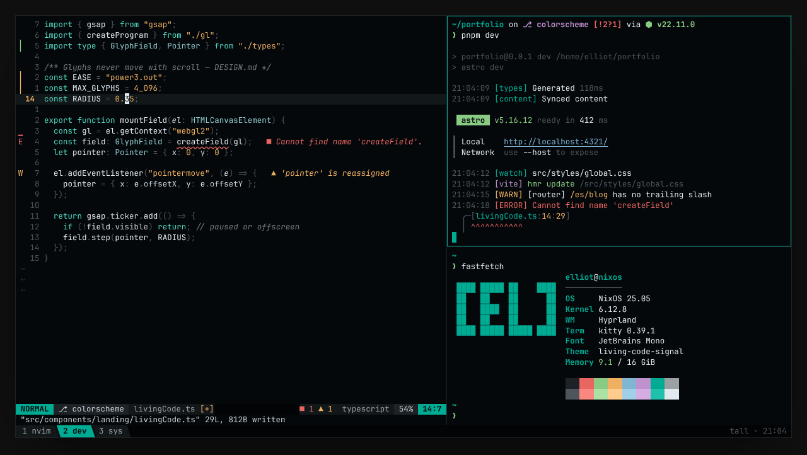
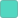
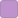
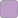
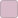
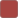

<h1 align="center">Living Code</h1>

<p align="center"><b>Calm slate. Living color.</b><br>
A color scheme where the background stays quiet and the code comes alive.<br>
For editors, terminals, browsers and the web.</p>

<p align="center">




</p>

## Choose a flavor

Every flavor shares the same slate foundation and semantic roles. Night is the default.

| Flavor | Appearance | Syntax and accents |
|---|---|---|
| [Night](#living-code-night) | Dark slate, full palette | Cool structure, green strings, copper numbers and amber warnings. The default. |
| [Frost](#living-code-frost) | Lifted, bluer slate | Lower-chroma accents with amber strings and copper numbers. |
| [Paper](#living-code-paper) | Near-white slate | Darker accents with amber strings and copper numbers. |
| [Signal](#living-code-signal) | Dark slate, one accent | Minimal variant of Night: teal keywords and tags, everything else neutral. |

## Install in 30 seconds

Nobody has to clone this repository. Each app installs the way it normally installs things: a marketplace or its built-in theme list where one exists, otherwise one copy-paste command.

| App | How to install |
|---|---|
| [Neovim](#neovim) | Plugin manager, see below |
| [VS Code](#vscode) | Marketplace: `code --install-extension elliotluque.living-code` |
| [JetBrains IDEs](#jetbrains) | Marketplace: *Settings | Plugins*, search **Living Code** |
| [Zed](#zed) | Extensions panel: search **Living Code** |
| [Helix](#helix) | One line, see below |
| [Sublime Text](#sublime) | One line, see below (Package Control pending a dedicated repo) |
| [bat · delta (tmTheme)](#tmtheme) | One line, see below |
| [kitty](#kitty) | One line, see below |
| [Ghostty](#ghostty) | One line, see below |
| [Alacritty](#alacritty) | One line, see below |
| [WezTerm](#wezterm) | One line, see below |
| [foot](#foot) | One line, see below |
| [Windows Terminal](#windows-terminal) | One PowerShell line, see below |
| [iTerm2](#iterm2) | One line, see below |
| [Warp](#warp) | One line, see below |
| [Konsole](#konsole) | One line, see below |
| [tmux](#tmux) | One line, see below |
| [fzf](#fzf) | One line, see below |
| [Starship](#starship) | One command block, see below |
| [btop](#btop) | One line, see below |
| [lazygit](#lazygit) | One command block, see below |
| [delta](#delta) | One command block, see below |
| [Hunk](#hunk) | One line, see below |
| [fish](#fish) | One line, see below |
| [zellij](#zellij) | One line, see below |
| [yazi](#yazi) | One line, see below |
| [k9s](#k9s) | One line, see below |
| [eza](#eza) | One line, see below |
| [Firefox](#firefox) | Firefox Add-ons: click **Install Theme** |
| [Chrome, Brave and Chromium](#chrome) | Release zip today (Chrome Web Store pending), see below |
| [Obsidian](#obsidian) | Community themes: search **Living Code** |
| [Slack](#slack) | Paste one theme string, see below |
| [Expressive Code](#expressive-code) | `npm i @living-code/expressive-code` |
| [CSS variables](#css) | `npm i @living-code/css` |
| [Tailwind CSS v4](#tailwind) | `npm i @living-code/tailwind` |
| [JSON / JavaScript](#json) | `npm i @living-code/palette` |
| [base16 · Stylix · tinted-theming](#base16) | Nix flake input, see below |

## Design

- **The ground stays calm.** Backgrounds, panels, selections, punctuation and comments live on one slate ramp, so the eye goes to the code, not the chrome.
- **Cool for structure, warm for data.**  Teal, aqua and steel mark keywords, functions and types;  moss,  amber and  copper mark strings, numbers and warnings.
- **Same roles everywhere.** Each port maps the same semantic roles (keyword, string, error, border...), so a theme feels the same in your editor, terminal and browser.
- **Built in OKLCH.** Every palette value is defined in OKLCH; hex and RGB are derived. The build checks text roles for WCAG AA contrast (≥ 4.5:1) against each flavor's background.

## Flavors

### Living Code Night

The default. Dark slate ground, teal structure, green strings and gray comments. Amber warnings and copper numbers keep their warm contrast.


<details open>
<summary>Palette</summary>

**Neutrals**

| | Name | Hex | OKLCH | Used for |
|:-:|---|---|---|---|
|  | `crust` | `#020405` | `oklch(0.1 0.01 240)` | sidebars, tab bars, status lines |
|  | `base` | `#05080b` | `oklch(0.13 0.01 240)` | background |
|  | `mantle` | `#090e11` | `oklch(0.16 0.01 240)` | floats, cards, popups |
|  | `surface0` | `#12171a` | `oklch(0.2 0.01 240)` | line highlight, inactive tabs |
|  | `surface1` | `#1d2226` | `oklch(0.25 0.01 240)` | borders, ANSI black |
|  | `surface2` | `#2d3438` | `oklch(0.32 0.012 240)` | selection |
|  | `overlay` | `#50565b` | `oklch(0.45 0.012 240)` | line numbers, punctuation |
|  | `comment` | `#747c80` | `oklch(0.58 0.012 235)` | comments, operators |
|  | `subtext` | `#9ba0a2` | `oklch(0.7023 0.0065 223.49)` | muted text, ANSI white |
|  | `text2` | `#c8cfd4` | `oklch(0.85 0.01 240)` | properties, parameters |
|  | `text` | `#e2e9ee` | `oklch(0.93 0.01 240)` | foreground |

**Accents**

| | Name | Hex | OKLCH | Used for |
|:-:|---|---|---|---|
|  | `teal` | `#00a692` | `oklch(0.65 0.15 180)` | accent · cursor · borderActive · heading |
|  | `mint` | `#52d7c1` | `oklch(0.8 0.12 180)` | hint · keyword · builtin |
|  | `aqua` | `#9ae0dd` | `oklch(0.86 0.07 192)` | function · link |
|  | `steel` | `#80b6d3` | `oklch(0.75 0.07 232)` | info · type · namespace |
|  | `amber` | `#f0be6d` | `oklch(0.83 0.115 78)` | lineNumberActive · match · warning · modified · code |
|  | `copper` | `#e18c5f` | `oklch(0.72 0.12 48)` | number · constant · escape |
|  | `flare` | `#e96560` | `oklch(0.67 0.165 25)` | error · removed |
|  | `moss` | `#8acb83` | `oklch(0.78 0.12 142)` | success · added · string |
|  | `orchid` | `#bf91cd` | `oklch(0.72 0.1 318)` | regex · decorator · tag |
|  | `rose` | `#ddaec3` | `oklch(0.8 0.06 350)` | Available for custom accents |

**ANSI**

| | black | red | green | yellow | blue | magenta | cyan | white |
|---|:-:|:-:|:-:|:-:|:-:|:-:|:-:|:-:|
| normal |  |  |  |  |  |  |  |  |
| bright |  |  |  |  |  |  |  |  |

</details>

### Living Code Frost

Night on a lifted, bluer slate with a third less chroma. Calmer for long sessions; the warm/cool split survives at low saturation.


<details>
<summary>Palette</summary>

**Neutrals**

| | Name | Hex | OKLCH | Used for |
|:-:|---|---|---|---|
|  | `crust` | `#050a0f` | `oklch(0.14 0.015 245)` | sidebars, tab bars, status lines |
|  | `base` | `#0a1016` | `oklch(0.17 0.015 245)` | background |
|  | `mantle` | `#10171c` | `oklch(0.2 0.015 245)` | floats, cards, popups |
|  | `surface0` | `#171e24` | `oklch(0.23 0.015 245)` | line highlight, inactive tabs |
|  | `surface1` | `#232a30` | `oklch(0.28 0.015 245)` | borders, ANSI black |
|  | `surface2` | `#333c43` | `oklch(0.35 0.018 245)` | selection |
|  | `overlay` | `#50565b` | `oklch(0.45 0.012 240)` | line numbers, punctuation |
|  | `comment` | `#7d8489` | `oklch(0.61 0.012 235)` | comments, operators |
|  | `subtext` | `#9ba0a2` | `oklch(0.7023 0.0065 223.49)` | muted text, ANSI white |
|  | `text2` | `#c8cfd4` | `oklch(0.85 0.01 240)` | properties, parameters |
|  | `text` | `#e2e9ee` | `oklch(0.93 0.01 240)` | foreground |

**Accents**

| | Name | Hex | OKLCH | Used for |
|:-:|---|---|---|---|
|  | `teal` | `#43a997` | `oklch(0.67 0.0975 180)` | accent · cursor · borderActive · heading |
|  | `mint` | `#8ad5c6` | `oklch(0.82 0.078 180)` | hint · keyword · builtin |
|  | `aqua` | `#b6e2df` | `oklch(0.88 0.0455 192)` | function · link |
|  | `steel` | `#98bacd` | `oklch(0.77 0.0455 232)` | info · type · namespace |
|  | `amber` | `#e9c897` | `oklch(0.85 0.0748 78)` | lineNumberActive · match · warning · modified · string · code |
|  | `copper` | `#d49c80` | `oklch(0.74 0.078 48)` | number · constant · escape |
|  | `flare` | `#d68079` | `oklch(0.69 0.1073 25)` | error · removed |
|  | `moss` | `#a2cb9d` | `oklch(0.8 0.078 142)` | success · added |
|  | `orchid` | `#bc9ec6` | `oklch(0.74 0.065 318)` | regex · decorator · tag |
|  | `rose` | `#d9bac8` | `oklch(0.82 0.039 350)` | Available for custom accents |

**ANSI**

| | black | red | green | yellow | blue | magenta | cyan | white |
|---|:-:|:-:|:-:|:-:|:-:|:-:|:-:|:-:|
| normal |  |  |  |  |  |  |  |  |
| bright |  |  |  |  |  |  |  |  |

</details>

### Living Code Paper

Daylight. Same two temperatures on near-white slate, lightness inverted so every syntax color keeps WCAG AA contrast.


<details>
<summary>Palette</summary>

**Neutrals**

| | Name | Hex | OKLCH | Used for |
|:-:|---|---|---|---|
|  | `crust` | `#e0e5e9` | `oklch(0.92 0.008 240)` | sidebars, tab bars, status lines |
|  | `base` | `#f4f7f9` | `oklch(0.975 0.004 240)` | background |
|  | `mantle` | `#ebeff2` | `oklch(0.95 0.006 240)` | floats, cards, popups |
|  | `surface0` | `#e3e9ed` | `oklch(0.93 0.008 240)` | line highlight, inactive tabs |
|  | `surface1` | `#d2d8dd` | `oklch(0.88 0.01 240)` | borders, ANSI black |
|  | `surface2` | `#c2ccd3` | `oklch(0.84 0.015 240)` | selection |
|  | `overlay` | `#92999f` | `oklch(0.68 0.012 240)` | line numbers, punctuation |
|  | `comment` | `#6b7378` | `oklch(0.55 0.012 235)` | comments, operators |
|  | `subtext` | `#50565a` | `oklch(0.45 0.01 240)` | muted text, ANSI white |
|  | `text2` | `#2e3437` | `oklch(0.32 0.01 240)` | properties, parameters |
|  | `text` | `#12171a` | `oklch(0.2 0.01 240)` | foreground |

**Accents**

| | Name | Hex | OKLCH | Used for |
|:-:|---|---|---|---|
|  | `teal` | `#187d6e` | `oklch(0.53 0.09 180)` | accent · cursor · borderActive · heading |
|  | `mint` | `#0f695e` | `oklch(0.47 0.08 182)` | hint · keyword · builtin |
|  | `aqua` | `#1f7074` | `oklch(0.5 0.075 200)` | function · link |
|  | `steel` | `#2b6991` | `oklch(0.5 0.09 240)` | info · type · namespace |
|  | `amber` | `#8f6213` | `oklch(0.53 0.105 75)` | lineNumberActive · match · warning · modified · string · code |
|  | `copper` | `#a04f27` | `oklch(0.52 0.12 45)` | number · constant · escape |
|  | `flare` | `#a74541` | `oklch(0.52 0.13 25)` | error · removed |
|  | `moss` | `#3b7a35` | `oklch(0.52 0.12 142)` | success · added |
|  | `orchid` | `#81558e` | `oklch(0.52 0.1 318)` | regex · decorator · tag |
|  | `rose` | `#845b6e` | `oklch(0.52 0.06 350)` | Available for custom accents |

**ANSI**

| | black | red | green | yellow | blue | magenta | cyan | white |
|---|:-:|:-:|:-:|:-:|:-:|:-:|:-:|:-:|
| normal |  |  |  |  |  |  |  |  |
| bright |  |  |  |  |  |  |  |  |

</details>

### Living Code Signal

A minimal variant of Night with a single accent. Teal marks keywords, tags and focus; everything else stays on the slate ramp. No warm literals or multicolor diagnostics.


Accent names such as `amber`, `copper` and `moss` remain available for port compatibility,
but in Signal they are aliases of teal or neutral colors. Diagnostics are told apart by labels, signs and underlines instead of hue.

<details>
<summary>Palette</summary>

**Neutrals**

| | Name | Hex | OKLCH | Used for |
|:-:|---|---|---|---|
|  | `crust` | `#020405` | `oklch(0.1 0.01 240)` | sidebars, tab bars, status lines |
|  | `base` | `#05080b` | `oklch(0.13 0.01 240)` | background |
|  | `mantle` | `#090e11` | `oklch(0.16 0.01 240)` | floats, cards, popups |
|  | `surface0` | `#12171a` | `oklch(0.2 0.01 240)` | line highlight, inactive tabs |
|  | `surface1` | `#1d2226` | `oklch(0.25 0.01 240)` | borders, ANSI black |
|  | `surface2` | `#2d3438` | `oklch(0.32 0.012 240)` | selection |
|  | `overlay` | `#50565b` | `oklch(0.45 0.012 240)` | line numbers, punctuation |
|  | `comment` | `#747c80` | `oklch(0.58 0.012 235)` | comments, operators |
|  | `subtext` | `#9ba0a2` | `oklch(0.7023 0.0065 223.49)` | muted text, ANSI white |
|  | `text2` | `#c8cfd4` | `oklch(0.85 0.01 240)` | properties, parameters |
|  | `text` | `#e2e9ee` | `oklch(0.93 0.01 240)` | foreground |

**Accent**

| | Name | Hex | OKLCH | Used for |
|:-:|---|---|---|---|
|  | `teal` | `#00a692` | `oklch(0.65 0.15 180)` | accent · cursor · borderActive · match · modified · keyword · builtin · decorator · tag · heading · link |

**ANSI**

| | black | red | green | yellow | blue | magenta | cyan | white |
|---|:-:|:-:|:-:|:-:|:-:|:-:|:-:|:-:|
| normal |  |  |  |  |  |  |  |  |
| bright |  |  |  |  |  |  |  |  |

</details>


### Syntax roles

| Role | Night | Frost | Paper | Signal |
|---|---|---|---|---|
| keyword |  `mint` |  `mint` |  `mint` |  `teal` |
| function |  `aqua` |  `aqua` |  `aqua` |  `text` |
| type |  `steel` |  `steel` |  `steel` |  `text2` |
| string |  `moss` |  `amber` |  `amber` |  `text` |
| number |  `copper` |  `copper` |  `copper` |  `text` |
| decorator |  `orchid` |  `orchid` |  `orchid` |  `teal` |
| property |  `text2` |  `text2` |  `text2` |  `text2` |
| operator |  `comment` |  `comment` |  `comment` |  `comment` |
| comment |  `comment` |  `comment` |  `comment` |  `comment` |

The table shows resolved roles for every flavor. The full role map (UI, diagnostics, markup) is in
[`palette/flavors.mjs`](palette/flavors.mjs): `defaultRoles` plus each flavor's `roles` overrides.

Every port ships every flavor: pick the `living-code-<flavor>` file, or in Neovim use `:colorscheme living-code-frost`
or set `flavor = "frost"` in the [plugin setup](#neovim). Browser themes (Firefox and Chrome) ship Night and Paper only. A browser theme colours just backgrounds, borders and one accent, and in those slots Frost and Signal would look the same as (or barely different from) Night; both browser stores reject duplicate themes. If you use Frost or Signal elsewhere, Night is the closest match in the browser.

## Ports

**Editors:** [Neovim](#neovim) · [VS Code](#vscode) · [JetBrains IDEs](#jetbrains) · [Zed](#zed) · [Helix](#helix) · [Sublime Text](#sublime) · [bat · delta (tmTheme)](#tmtheme)

**Terminals:** [kitty](#kitty) · [Ghostty](#ghostty) · [Alacritty](#alacritty) · [WezTerm](#wezterm) · [foot](#foot) · [Windows Terminal](#windows-terminal) · [iTerm2](#iterm2) · [Warp](#warp) · [Konsole](#konsole)

**CLI & TUI:** [tmux](#tmux) · [fzf](#fzf) · [Starship](#starship) · [btop](#btop) · [lazygit](#lazygit) · [delta](#delta) · [Hunk](#hunk) · [fish](#fish) · [zellij](#zellij) · [yazi](#yazi) · [k9s](#k9s) · [eza](#eza)

**Browsers:** [Firefox](#firefox) · [Chrome, Brave and Chromium](#chrome)

**Apps:** [Obsidian](#obsidian) · [Slack](#slack)

**Web & code:** [Expressive Code](#expressive-code) · [CSS variables](#css) · [Tailwind CSS v4](#tailwind) · [JSON / JavaScript](#json)

**Theme systems:** [base16 · Stylix · tinted-theming](#base16)

Every file in `extras/`, `colors/` and `lua/living-code/palettes/` is generated. Install instructions are below.

## Installation

### npm packages

Ports used from JavaScript or CSS tooling are published to npm. Each package contains only that port's files.

| Port | Package |
|---|---|
| [Expressive Code](#expressive-code) | `@living-code/expressive-code` |
| [CSS variables](#css) | `@living-code/css` |
| [Tailwind CSS v4](#tailwind) | `@living-code/tailwind` |
| [JSON / JavaScript](#json) | `@living-code/palette` |

Native apps (editors, terminals, CLI tools, browsers) don't need a package: use the app's own install route or the one-line command in its section below. The generated files are in [`extras/`](extras).

### Editors

<a id="neovim"></a>
#### [Neovim](https://neovim.io)

This repo is a Neovim plugin.

```lua
{
  "ElliotLuque/living-code",
  priority = 1000,
  config = function()
    require("living-code").setup({
      flavor = "night",
      transparent = false,
      italic_comments = true,
    })
    vim.cmd.colorscheme("living-code")
  end,
}
```

Or pick a flavor directly: `:colorscheme living-code-signal`. Covers Tree-sitter, LSP semantic tokens, diagnostics, gitsigns, telescope, nvim-cmp / blink.cmp, which-key, mini.*, lualine (`theme = "living-code"`).

<a id="vscode"></a>
#### [VS Code](https://code.visualstudio.com)

Open the Extensions view (`Ctrl+Shift+X`), search for **Living Code** and click **Install**, or run:

```sh
code --install-extension elliotluque.living-code
```

Then pick **Living Code Night**, **Frost**, **Paper** or **Signal** in *Preferences: Color Theme*.

**Cursor, VSCodium, Windsurf and other forks** install from [Open VSX](https://open-vsx.org/extension/elliotluque/living-code): search for **Living Code** in their Extensions view.

**Without a marketplace:** once a release has been published, download `living-code-<version>.vsix` from the [latest GitHub release](https://github.com/ElliotLuque/living-code/releases/latest) and run `code --install-extension living-code-<version>.vsix` (or *Extensions: Install from VSIX...*). To build it yourself: `cd extras/vscode && pnpm dlx @vscode/vsce package --no-dependencies`. This README assumes the extension is published to both marketplaces.

The same JSON works with **Shiki**. For Astro and other Expressive Code integrations, use the dedicated [Expressive Code port](#expressive-code).

<a id="jetbrains"></a>
#### [JetBrains IDEs](https://www.jetbrains.com/ides/)

One plugin, four themes, for IntelliJ IDEA, PyCharm, WebStorm, GoLand, Rider, CLion, RubyMine, PhpStorm, DataGrip and Android Studio (2024.1 or newer).

In the IDE open *Settings | Plugins | Marketplace*, search for **Living Code** and click **Install**, then pick **Living Code Night** (or Frost, Paper, Signal) in *Settings | Appearance & Behavior | Appearance | Theme*; the matching editor color scheme is applied with it.

**Without a marketplace:** download `living-code-jetbrains-0.1.1.zip` from the [latest GitHub release](https://github.com/ElliotLuque/living-code/releases/latest) (or build it with `pnpm run package:jetbrains` from a checkout, which writes it to `dist/jetbrains/`). In *Settings | Plugins*, click the gear icon, choose *Install Plugin from Disk...*, pick the zip and restart. This README assumes the plugin is published to the JetBrains Marketplace.

The sources in `extras/jetbrains/` are the plugin's layout: `META-INF/plugin.xml`, one `themes/living-code-<flavor>.theme.json` UI theme and one `themes/living-code-<flavor>.xml` editor scheme per flavor. This port has not been tested in a JetBrains IDE yet.

<a id="zed"></a>
#### [Zed](https://zed.dev)

In Zed, open the Extensions panel (`zed: extensions`, or `cmd-shift-x` on macOS and `ctrl-shift-x` on Linux), search for **Living Code**, and click **Install**. Then pick a flavor with `theme selector: toggle` (`cmd-k cmd-t`).

Without the registry: run `zed: install dev extension` and select the `extras/zed` folder of a checkout, or download the theme file into `~/.config/zed/themes/`:

```sh
mkdir -p ~/.config/zed/themes
curl -fsSL https://raw.githubusercontent.com/ElliotLuque/living-code/main/extras/zed/themes/living-code.json -o ~/.config/zed/themes/living-code.json
```

The theme file holds all four flavors. This README assumes the extension is published to the Zed registry.

<a id="helix"></a>
#### [Helix](https://helix-editor.com)

```sh
flavor=night
curl -fsSL --create-dirs -o "${XDG_CONFIG_HOME:-$HOME/.config}/helix/themes/living-code-$flavor.toml" "https://raw.githubusercontent.com/ElliotLuque/living-code/main/extras/helix/living-code-$flavor.toml"
```

Then set the theme in `config.toml`:

```toml
theme = "living-code-night"
```

On Windows the folder is `%AppData%\helix\themes`.

<a id="sublime"></a>
#### [Sublime Text](https://www.sublimetext.com)

Targets Sublime Text 4. It uses the modern `.sublime-color-scheme` format, one file per flavor.

Download the four color schemes into your `Packages/User` folder (the same folder as *Preferences → Browse Packages…*), then pick *Preferences → Select Color Scheme → Living Code Night* (or *UI: Select Color Scheme*). Flavors: Night, Frost, Paper and Signal.

Linux:

```sh
curl -fsSL --create-dirs --output-dir "${XDG_CONFIG_HOME:-$HOME/.config}/sublime-text/Packages/User" -O "https://raw.githubusercontent.com/ElliotLuque/living-code/main/extras/sublime/living-code-{night,frost,paper,signal}.sublime-color-scheme"
```

macOS:

```sh
curl -fsSL --create-dirs --output-dir "$HOME/Library/Application Support/Sublime Text/Packages/User" -O "https://raw.githubusercontent.com/ElliotLuque/living-code/main/extras/sublime/living-code-{night,frost,paper,signal}.sublime-color-scheme"
```

**Package Control, once published.** Package Control needs a dedicated repository for the package, which does not exist yet. When it is listed, run *Package Control: Install Package* and choose **Living Code**. Until then, use the download above.

The source files are in [`extras/sublime/`](extras/sublime). To customize a manual install, edit the copied file. With the Package Control install, add a `Packages/User/<Scheme>.sublime-color-scheme` with the same file name as the package scheme and override entries under `variables` or `globals`.

`pnpm run package:sublime` builds `dist/sublime/Living Code.sublime-package` from the same generator. The [bat · delta (tmTheme) port](#tmtheme) stays for bat and delta; Sublime Text should use this native scheme.

<a id="tmtheme"></a>
#### [bat · delta (tmTheme)](https://github.com/sharkdp/bat)

**bat / delta**

```sh
curl -fsSL --create-dirs --output-dir "$(bat --config-dir)/themes" -O "https://raw.githubusercontent.com/ElliotLuque/living-code/main/extras/tmtheme/living-code-{night,frost,paper,signal}.tmTheme" && bat cache --build
bat --list-themes | grep living-code
```

Then `--theme="living-code-night"` in `$(bat --config-dir)/config`, and `syntax-theme = living-code-night` under `[delta]` in `~/.gitconfig`. For delta's diff backgrounds, headers and gutters, also use the dedicated [delta port](https://github.com/ElliotLuque/living-code#delta).

**Sublime Text** has its own native color scheme: use the dedicated [Sublime Text port](#sublime). The `.tmTheme` files are kept for bat and delta.

### Terminals

<a id="kitty"></a>
#### [kitty](https://sw.kovidgoyal.net/kitty/)

```sh
flavor=night
curl -fsSL --create-dirs -o "${XDG_CONFIG_HOME:-$HOME/.config}/kitty/themes/living-code-$flavor.conf" "https://raw.githubusercontent.com/ElliotLuque/living-code/main/extras/kitty/living-code-$flavor.conf"
```

Then include it from `kitty.conf`:

```conf
include themes/living-code-night.conf
```

`kitten themes` also lists it under your own themes, where you can apply it and reload every window.

<a id="ghostty"></a>
#### [Ghostty](https://ghostty.org)

```sh
curl -fsSL --create-dirs --output-dir "${XDG_CONFIG_HOME:-$HOME/.config}/ghostty/themes" -O "https://raw.githubusercontent.com/ElliotLuque/living-code/main/extras/ghostty/living-code-{night,frost,paper,signal}"
```

Then name one in the Ghostty config, or a light and a dark one:

```conf
theme = dark:living-code-night,light:living-code-paper
```

<a id="alacritty"></a>
#### [Alacritty](https://alacritty.org)

```sh
flavor=night
curl -fsSL --create-dirs -o "${XDG_CONFIG_HOME:-$HOME/.config}/alacritty/themes/living-code-$flavor.toml" "https://raw.githubusercontent.com/ElliotLuque/living-code/main/extras/alacritty/living-code-$flavor.toml"
```

Then import it in `alacritty.toml`:

```toml
[general]
import = ["~/.config/alacritty/themes/living-code-night.toml"]
```

If you set `XDG_CONFIG_HOME`, use that path in the `import` line. On Windows the folder is `%APPDATA%\alacritty\themes`.

<a id="wezterm"></a>
#### [WezTerm](https://wezterm.org)

```sh
curl -fsSL --create-dirs --output-dir "${XDG_CONFIG_HOME:-$HOME/.config}/wezterm/colors" -O "https://raw.githubusercontent.com/ElliotLuque/living-code/main/extras/wezterm/living-code-{night,frost,paper,signal}.toml"
```

Then select the scheme in `wezterm.lua`:

```lua
config.color_scheme = "Living Code Night"
```

<a id="foot"></a>
#### [foot](https://codeberg.org/dnkl/foot)

```sh
flavor=night
curl -fsSL --create-dirs -o "${XDG_CONFIG_HOME:-$HOME/.config}/foot/living-code-$flavor.ini" "https://raw.githubusercontent.com/ElliotLuque/living-code/main/extras/foot/living-code-$flavor.ini"
```

Then include it at the top of `foot.ini`:

```ini
[main]
include=~/.config/foot/living-code-night.ini
```

If you set `XDG_CONFIG_HOME`, use that path in the `include` line.

<a id="windows-terminal"></a>
#### [Windows Terminal](https://github.com/microsoft/terminal)

Run this in PowerShell. It saves a [JSON fragment](https://learn.microsoft.com/en-us/windows/terminal/json-fragment-extensions) that Windows Terminal loads by itself, so nothing in `settings.json` is edited:

```powershell
$d = "$env:LOCALAPPDATA\Microsoft\Windows Terminal\Fragments\living-code"; New-Item -ItemType Directory -Force $d | Out-Null; Invoke-WebRequest https://raw.githubusercontent.com/ElliotLuque/living-code/main/extras/windows-terminal/living-code.json -OutFile "$d\living-code.json" -UseBasicParsing
```

Restart Windows Terminal. The four schemes appear in *Settings → Color schemes*; select one under a profile's *Appearance*, or set it in `settings.json`:

```json
"colorScheme": "Living Code Night"
```

Fallback: paste the scheme objects from `extras/windows-terminal/living-code-*.json` into the `schemes` array of `settings.json`.

<a id="iterm2"></a>
#### [iTerm2](https://iterm2.com)

Download a preset and `open` it; iTerm2 imports it and names the preset after the file. The command saves the files with spaces so the presets read *Living Code Night*, *Living Code Frost*, *Living Code Paper* and *Living Code Signal*:

```sh
curl -fsSL -o "$HOME/Downloads/Living Code #1.itermcolors" "https://raw.githubusercontent.com/ElliotLuque/living-code/main/extras/iterm2/Living-Code-{Night,Frost,Paper,Signal}.itermcolors" && open "$HOME"/Downloads/Living\ Code\ *.itermcolors
```

Then pick one under *Settings → Profiles → Colors → Color Presets*. Fallback: in that same menu choose *Import...* and select the downloaded files.

<a id="warp"></a>
#### [Warp](https://www.warp.dev)

Download the themes into Warp's [custom themes folder](https://docs.warp.dev/terminal/appearance/custom-themes), then pick one under *Settings → Appearance → Themes*. macOS:

```sh
curl -fsSL --create-dirs --output-dir ~/.warp/themes -O "https://raw.githubusercontent.com/ElliotLuque/living-code/main/extras/warp/living-code-{night,frost,paper,signal}.yaml"
```

Linux:

```sh
curl -fsSL --create-dirs --output-dir "${XDG_DATA_HOME:-$HOME/.local/share}/warp-terminal/themes" -O "https://raw.githubusercontent.com/ElliotLuque/living-code/main/extras/warp/living-code-{night,frost,paper,signal}.yaml"
```

On Windows the folder is `%APPDATA%\warp\Warp\data\themes\`. If a theme does not show up straight away, restart Warp.

<a id="konsole"></a>
#### [Konsole](https://konsole.kde.org)

```sh
curl -fsSL --create-dirs --output-dir ~/.local/share/konsole -O "https://raw.githubusercontent.com/ElliotLuque/living-code/main/extras/konsole/living-code-{night,frost,paper,signal}.colorscheme"
```

Then open *Settings → Edit Current Profile → Appearance* and select the color scheme. Konsole picks up new files in that folder without a restart.

### CLI & TUI

<a id="tmux"></a>
#### [tmux](https://github.com/tmux/tmux)

```sh
flavor=night
curl -fsSL --create-dirs -o "${XDG_CONFIG_HOME:-$HOME/.config}/tmux/living-code-$flavor.conf" "https://raw.githubusercontent.com/ElliotLuque/living-code/main/extras/tmux/living-code-$flavor.conf"
```

Then load it from `tmux.conf`:

```tmux
source-file ~/.config/tmux/living-code-night.conf
```

If you set `XDG_CONFIG_HOME`, use that path in the line above.

<a id="fzf"></a>
#### [fzf](https://github.com/junegunn/fzf)

```sh
flavor=night
curl -fsSL --create-dirs -o "${XDG_CONFIG_HOME:-$HOME/.config}/fzf/living-code-$flavor.sh" "https://raw.githubusercontent.com/ElliotLuque/living-code/main/extras/fzf/living-code-$flavor.sh"
```

Then source it from `~/.bashrc` or `~/.zshrc`:

```sh
. "${XDG_CONFIG_HOME:-$HOME/.config}/fzf/living-code-night.sh"
```

For fish, download `living-code-$flavor.fish` from the same folder of the repository instead and `source` it from `config.fish`. Source it after any line that sets `FZF_DEFAULT_OPTS`.

<a id="starship"></a>
#### [Starship](https://starship.rs)

Starship needs the `palette = ...` line at the top of the file and the palette table after your own settings, so this puts each in place. It is safe to run again with another `flavor=`: it first removes the `palette` line and any earlier Living Code palette table, and keeps everything else (a `palette` line you set yourself is replaced too). Starship reads `$STARSHIP_CONFIG` or `~/.config/starship.toml`, not `XDG_CONFIG_HOME`:

```sh
flavor=night
cfg="${STARSHIP_CONFIG:-$HOME/.config/starship.toml}"
mkdir -p "$(dirname "$cfg")" && touch "$cfg"
p="$(curl -fsSL "https://raw.githubusercontent.com/ElliotLuque/living-code/main/extras/starship/living-code-$flavor.toml")" && { printf '%s\n' "$p" | head -n 1; awk 'BEGIN{top=1} /^\[/{top=0; skip=($0 ~ /^\[palettes\.living_code_/)} skip{next} top && /^palette[ \t]*=/{next} /^[ \t]*$/{n++; next} {for(;n>0;n--) print ""; print}' "$cfg"; printf '\n'; printf '%s\n' "$p" | tail -n +2; } > "$cfg.new" && mv "$cfg.new" "$cfg"
```

Module styles can then use names like `"bold teal"` or `"amber"`.

<a id="btop"></a>
#### [btop](https://github.com/aristocratos/btop)

```sh
flavor=night
curl -fsSL --create-dirs -o "${XDG_CONFIG_HOME:-$HOME/.config}/btop/themes/living-code-$flavor.theme" "https://raw.githubusercontent.com/ElliotLuque/living-code/main/extras/btop/living-code-$flavor.theme"
```

Then pick it under *Options → Color theme*, or set `color_theme = "living-code-night"` in `btop.conf`.

<a id="lazygit"></a>
#### [lazygit](https://github.com/jesseduffield/lazygit)

lazygit accepts a comma-separated list of config files, so the theme sits next to your own config without editing it. `lazygit --print-config-dir` finds the right folder on every OS:

```sh
flavor=night
dir="$(lazygit --print-config-dir)"
mkdir -p "$dir" && touch "$dir/config.yml"
curl -fsSL --create-dirs -o "$dir/living-code-$flavor.yml" "https://raw.githubusercontent.com/ElliotLuque/living-code/main/extras/lazygit/living-code-$flavor.yml"
export LG_CONFIG_FILE="$dir/config.yml,$dir/living-code-$flavor.yml"
```

Put the `export` line in your shell profile to keep it. Or merge the downloaded `theme:` block into `config.yml` by hand.

<a id="delta"></a>
#### [delta](https://github.com/dandavison/delta)

First install the [tmTheme port](https://github.com/ElliotLuque/living-code#tmtheme) into bat's cache for syntax colors. This port adds delta's diff backgrounds, word highlights, headers and gutters.

```sh
curl -fsSL --create-dirs -o "${XDG_CONFIG_HOME:-$HOME/.config}/delta/living-code.gitconfig" "https://raw.githubusercontent.com/ElliotLuque/living-code/main/extras/delta/living-code.gitconfig"
git config --global --add include.path "${XDG_CONFIG_HOME:-$HOME/.config}/delta/living-code.gitconfig"
git config --global core.pager delta
git config --global interactive.diffFilter "delta --color-only"
git config --global delta.features living-code-night
```

That includes the file in `~/.gitconfig` and selects a flavor. Skip the `core.pager` and `diffFilter` lines if delta is already set up.

Each flavor is a delta feature: `living-code-night`, `living-code-signal`, `living-code-frost`, `living-code-paper`.

<a id="hunk"></a>
#### [Hunk](https://github.com/modem-dev/hunk)

**Extension (all flavors):** download the generated extension:

```sh
curl -fsSL --create-dirs -o "$HOME/.config/hunk/extensions/living-code.mjs" "https://raw.githubusercontent.com/ElliotLuque/living-code/main/extras/hunk/living-code.mjs"
```

Set the top-level `theme` in `~/.config/hunk/config.toml` (before any TOML tables):

```toml
theme = "living-code-night"
```

To try it first, run `hunk diff --extension ~/.config/hunk/extensions/living-code.mjs --theme living-code-night`.

**Config only:** instead of the extension, merge a flavor's `.toml` file into `~/.config/hunk/config.toml` (or a repo's `.hunk/config.toml`) and set the top-level `theme` as above. Do not add duplicate theme tables. Config themes take precedence over extension themes with the same name.

Available themes: `living-code-night`, `living-code-signal`, `living-code-frost`, `living-code-paper`. Syntax colors share the editor ports' scope map.

<a id="fish"></a>
#### [fish](https://fishshell.com)

Needs fish 3.4 or newer. Download the themes, then choose one:

```fish
curl -fsSL --create-dirs --output-dir ~/.config/fish/themes -O "https://raw.githubusercontent.com/ElliotLuque/living-code/main/extras/fish/living-code-{night,frost,paper,signal}.theme"
echo 'fish_config theme choose living-code-night' >> ~/.config/fish/config.fish
```

Run `fish_config theme choose living-code-night` on its own to try a flavor in the current session; the `config.fish` line makes it stick. `fish_config theme save living-code-night` also works but asks for confirmation. `fish_config theme list` shows the other flavors.

<a id="zellij"></a>
#### [zellij](https://zellij.dev)

These use zellij's component-based [theme format](https://zellij.dev/documentation/themes.html), so they need a zellij release that supports it. Download the themes into the `themes` folder of your config directory, then name one in `config.kdl`:

```sh
curl -fsSL --create-dirs --output-dir ~/.config/zellij/themes -O "https://raw.githubusercontent.com/ElliotLuque/living-code/main/extras/zellij/living-code-{night,frost,paper,signal}.kdl"
```

```kdl
theme "living-code-night"
```

`zellij setup --check` prints the exact config directory if yours is elsewhere.

<a id="yazi"></a>
#### [yazi](https://yazi-rs.github.io)

`ya pkg add` cannot install these straight from this repository. It looks for a `<name>.yazi` folder at the root of the repository (`ya pkg add owner/repo:name`), and Living Code keeps its flavors under `extras/yazi/` rather than adding folders at the root. So download the flavors by hand:

```sh
curl -fsSL --create-dirs -o "$HOME/.config/yazi/flavors/living-code-#1.yazi/#2" "https://raw.githubusercontent.com/ElliotLuque/living-code/main/extras/yazi/living-code-{night,frost,paper,signal}.yazi/{flavor.toml,tmtheme.xml,LICENSE}"
```

Then name them in `~/.config/yazi/theme.toml`:

```toml
[flavor]
dark = "living-code-night"
light = "living-code-paper"
```

On Windows the flavors folder is `%AppData%\yazi\config\flavors`.

<a id="k9s"></a>
#### [k9s](https://k9scli.io)

Download the skins, then select one in `config.yaml`:

```sh
curl -fsSL --create-dirs --output-dir "${XDG_CONFIG_HOME:-$HOME/.config}/k9s/skins" -O "https://raw.githubusercontent.com/ElliotLuque/living-code/main/extras/k9s/living-code-{night,frost,paper,signal}.yaml"
```

```yaml
k9s:
  ui:
    skin: living-code-night
```

On macOS, where `XDG_CONFIG_HOME` is usually unset, k9s keeps its config in `~/Library/Application Support/k9s`, so use this line instead (and edit `config.yaml` there):

```sh
curl -fsSL --create-dirs --output-dir ~/Library/Application\ Support/k9s/skins -O "https://raw.githubusercontent.com/ElliotLuque/living-code/main/extras/k9s/living-code-{night,frost,paper,signal}.yaml"
```

`k9s info` prints the directory your install uses.

<a id="eza"></a>
#### [eza](https://eza.rocks)

Needs eza 0.19 or newer. eza reads a single `theme.yml` from `$EZA_CONFIG_DIR`, or else from `${XDG_CONFIG_HOME:-~/.config}/eza/` on Linux and `~/Library/Application Support/eza/` on macOS, so download the flavor you want under that name:

```sh
flavor=night
dir="${EZA_CONFIG_DIR:-${XDG_CONFIG_HOME:-$HOME/.config}/eza}"   # macOS: dir="$HOME/Library/Application Support/eza"
curl -fsSLo "$dir/theme.yml" --create-dirs https://raw.githubusercontent.com/ElliotLuque/living-code/main/extras/eza/living-code-$flavor.yml
```

Set `flavor` to `frost`, `paper` or `signal` to use another flavor. eza only colors what `LS_COLORS` / `EZA_COLORS` do not already set, so unset those variables if the theme seems to have no effect.

### Browsers

<a id="firefox"></a>
#### [Firefox](https://www.firefox.com)

Choose **Night** for a dark browser or **Paper** for a light one.

1. Open [Living Code Night](https://addons.mozilla.org/firefox/addon/living-code-night/) or [Living Code Paper](https://addons.mozilla.org/firefox/addon/living-code-paper/) on Firefox Add-ons.
2. Click **Install Theme**.

To switch themes, open **Add-ons and themes → Themes** (`about:addons`) and enable your preferred variant.

<a id="chrome"></a>
#### [Chrome, Brave and Chromium](https://chromewebstore.google.com/category/themes)

Choose **Night** for a dark browser or **Paper** for a light one. They are Manifest V3 themes for Chrome and Chromium; Brave installs Chrome themes too. Vivaldi does not apply Chrome themes, and Edge, Opera and Arc have not been tested.

1. **Release zip:** download `living-code-chrome-night.zip` or `living-code-chrome-paper.zip` from the latest [GitHub release](https://github.com/ElliotLuque/living-code/releases/latest) and unzip it. Open `chrome://extensions`, turn on **Developer mode**, click **Load unpacked** and select the folder. (From a checkout, select `extras/chrome/living-code-night` or `extras/chrome/living-code-paper`.)
2. **Chrome Web Store, once listed:** Neither theme is listed yet. When they are, search for **Living Code Night** or **Living Code Paper** and click **Add to Chrome**.

To switch themes, install the other one, or use **Settings → Appearance → Reset to default**.

### Apps

<a id="obsidian"></a>
#### [Obsidian](https://obsidian.md)

Obsidian's dark mode is **Night** and its light mode is **Paper**; the theme follows *Appearance → Base color scheme*.

1. Open *Settings → Appearance → Themes → Manage*, search for **Living Code** and click **Install and use**. This README assumes the theme is listed in Obsidian's community themes.
2. **Without the directory:** copy `manifest.json` and `theme.css` from [`extras/obsidian/`](extras/obsidian) into `<vault>/.obsidian/themes/Living Code/`, then pick **Living Code** under *Appearance → Themes*.

**Frost and Signal** are dark flavors, so they ship as CSS snippets rather than as a Style Settings option, which would need a second plugin: copy `snippets/living-code-frost.css` or `snippets/living-code-signal.css` into `<vault>/.obsidian/snippets/` and enable it under *Appearance → CSS snippets*.

<a id="slack"></a>
#### [Slack](https://slack.com)

Open your profile picture menu → *Preferences → Appearance → Custom theme*, click *Import theme* next to *Theme Colors*, choose *Paste your legacy theme colors*, paste one of these strings and click *Apply*:

- **Night**: `#020405,#12171a,#00a692,#05080b,#12171a,#e2e9ee,#8acb83,#e96560`
- **Frost**: `#050a0f,#171e24,#43a997,#0a1016,#171e24,#e2e9ee,#a2cb9d,#333c43`
- **Paper**: `#e0e5e9,#e3e9ed,#187d6e,#f4f7f9,#e3e9ed,#12171a,#3b7a35,#a74541`
- **Signal**: `#020405,#12171a,#00a692,#05080b,#12171a,#e2e9ee,#c8cfd4,#00a692`

The eight colors are: column background, menu background hover, active item, active item text, hover item, text color, active presence, mention badge. Slack colors only its own interface, not code. These strings follow Slack's [help article](https://slack.com/help/articles/205166337-Change-your-Slack-theme) and have not been tested in a Slack client.

### Web & code

<a id="expressive-code"></a>
#### [Expressive Code](https://expressive-code.com)

Use the dedicated themes for syntax highlighting, editor and terminal frames, copy buttons, line numbers, and highlighted or diff lines.

For Astro:

```sh
pnpm add @living-code/expressive-code astro-expressive-code
```

Add the integration to `astro.config.mjs`:

```js
import { defineConfig } from "astro/config";
import expressiveCode from "astro-expressive-code";
import night from "@living-code/expressive-code/living-code-night.json" with { type: "json" };
import paper from "@living-code/expressive-code/living-code-paper.json" with { type: "json" };

export default defineConfig({
  integrations: [expressiveCode({ themes: [night, paper] })],
});
```

Night and Paper follow the visitor’s dark/light preference by default. Replace Night with `living-code-frost.json` or `living-code-signal.json` for another dark flavor, or pass a single theme for a fixed appearance.

**Starlight:** pass the same `themes` array to `starlight({ expressiveCode: { themes: [night, paper] } })` instead of adding a separate integration. For other integrations, pass these JSON objects to their Expressive Code `themes` option. When using the `ExpressiveCode` JavaScript API directly, wrap each JSON object in `new ExpressiveCodeTheme(theme)` (imported from `expressive-code`).

<a id="css"></a>
#### [CSS variables](https://developer.mozilla.org/docs/Web/CSS/color_value/oklch)

```sh
pnpm add @living-code/css
```

Import the stylesheet in your app:

```css
@import "@living-code/css/living-code.css";
```

Or load it directly in HTML:

```html
<link rel="stylesheet" href="living-code.css" />
<html data-theme="living-code-night">
```

Use palette names (`var(--lc-teal)`) or semantic roles (`var(--lc-keyword)`, `var(--lc-bg)`, `var(--lc-border-active)`).

<a id="tailwind"></a>
#### [Tailwind CSS v4](https://tailwindcss.com)

```sh
pnpm add @living-code/css @living-code/tailwind
```

```css
@import "tailwindcss";
@import "@living-code/css/living-code.css";
@import "@living-code/tailwind/living-code.css";
```

Then `bg-lc-base text-lc-text border-lc-surface1`, `text-lc-keyword`, etc.

<a id="json"></a>
#### [JSON / JavaScript](https://github.com/ElliotLuque/living-code)

```sh
pnpm add @living-code/palette
```

```js
import { palette } from "@living-code/palette";
palette.night.colors.teal.hex;
palette.night.roles.keyword;
```

Or read `palette.json` from any language.

### Theme systems

<a id="base16"></a>
#### [base16 · Stylix · tinted-theming](https://github.com/tinted-theming/home)

**Stylix (NixOS / home-manager)**

```nix
inputs.living-code = { url = "github:ElliotLuque/living-code"; flake = false; };

stylix.base16Scheme = "${inputs.living-code}/extras/base16/living-code-night.yaml";
stylix.polarity = "dark";
```

base16 has 16 slots shared between ANSI and syntax, so Stylix-generated themes get Living Code *colors* with base16 *roles*
(teal accents, but strings green and keywords purple). For apps where the native port exists, disable the Stylix target and
use the port for exact Living Code syntax. For example, `stylix.targets.kitty.enable = false` + `programs.kitty.extraConfig = "include ${inputs.living-code}/extras/kitty/living-code-night.conf"`, and the same for `neovim`, `vscode`, `bat`, `helix`, `zed`.

Also works with **tinted-theming** tools (`tinty`, `flavours`, base16-shell): copy the YAML into their schemes directory.


## Using the palette in something else

Any app can follow the theme: read [`palette.json`](palette.json) (hex, OKLCH, RGB, roles and ANSI for every flavor),
or map these semantic roles onto the app's own color slots:

| Slot | Role | Night |
|---|---|---|
| background / foreground | `bg` / `fg` | `#05080b` / `#e2e9ee` |
| panels, sidebars | `bgDeep`, `bgAlt` | `#020405`, `#090e11` |
| accent, cursor, focus ring | `accent` | `#00a692` |
| selection | `selection` | `#2d3438` |
| borders | `border` / `borderActive` | `#1d2226` / `#00a692` |
| error / warning / info / success | `error` … | `#e96560` `#f0be6d` `#80b6d3` `#8acb83` |

## Recolor images

Turn any image, such as a wallpaper, into a Living Code version. Requires [ImageMagick 7](https://imagemagick.org).

```sh
node scripts/recolor.mjs wallpaper.jpg --flavor night --mode lut
```

| Mode | Result |
|---|---|
| `lut` | Starts with the theme's slate ramp. Shadows and muted areas stay neutral; colorful midtones receive the selected flavor's accents over that base. Lightness is fitted to the theme's range. Tune the accent amount with `--color` (default: 0.65). Core accents are teal, mint, aqua, steel, amber and copper; `--accents all` includes the remaining accents. |
| `gradient` | Maps brightness onto dark slate, an accent and light text. Pick the accent with `--accent amber`. |
| `remap` | Posterizes to the exact palette colors. Add `--no-dither` for flat areas. |
| `all` | Writes one file per mode. |

In `lut` mode, `--color 0` uses only the slate ramp; `--color 1` allows stronger accents while still protecting shadows and muted areas.
Unlike `--strength`, lowering `--color` does not bring back the original photo's colors. It controls accent blending, not a fixed percentage of the image's area.
Other controls are `--spread` (hue blending), `--keep-light` (brightness preservation) and `--smooth` (color-noise smoothing).
Use `--flavor signal` for slate and teal only; compatibility names such as `amber` do not add warm hues in Signal.

Output defaults to `<image>-<flavor>-<mode>.png` next to the input. Run with `--help` for every option.

## Contributing a port

1. Add a generator to `scripts/ports/`: a pure function from a resolved flavor to files.
2. Register it in `scripts/ports/index.mjs`.
3. `node scripts/build.mjs` regenerates everything, including this README.

If the port is consumed from JavaScript or CSS, set `npm: "<name>"` on it to publish it as `@living-code/<name>`.
Packages are built with `pnpm run build:packages`. Release instructions: [Publishing](docs/PUBLISHING.md). Where each port is listed, and what is left to submit: [Distribution](docs/DISTRIBUTION.md).

Lead a port's `install` text with the app's marketplace or built-in route, or with a one-line download command built from `rawUrl` in `scripts/ports/util.mjs` (never `git clone` or `cp extras/...`), and add the port to `QUICK` in `scripts/ports/index.mjs` for the table above.

Regenerate the README preview images with `pnpm run screenshots`. This uses headless Chrome (`google-chrome` by default;
set `CHROME_BIN` for another Chromium executable) and captures all four flavors from the live preview at 1280×720.
The scenes are illustrative editor and terminal previews, not screenshots of installed applications.

Live preview with sliders and every port's output: `node scripts/serve.mjs` → <http://localhost:4173/preview/>.

To change a color, edit [`palette/flavors.mjs`](palette/flavors.mjs) and rebuild. Do not edit generated files directly.

## License

[MIT](LICENSE) © Elliot Luque
