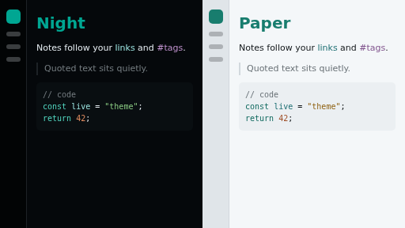

# Living Code for Obsidian

An Obsidian theme from [Living Code](https://github.com/ElliotLuque/living-code). Dark mode is **Night** and light mode is **Paper**, so the theme follows Obsidian's *Appearance → Base color scheme*.

## Install

*Settings → Appearance → Themes → Manage*, search for **Living Code** and click **Install and use**.

## Frost and Signal

Frost and Signal are dark flavors, so they ship as CSS snippets. Copy `snippets/living-code-frost.css` or `snippets/living-code-signal.css` into `<vault>/.obsidian/snippets/` and enable it under *Appearance → CSS snippets*. A snippet replaces the dark mode colors of the theme.

## License

MIT
